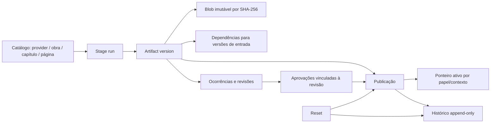

# M2 — Modelo conceitual de persistência da Onda 1

**Status:** proposta para revisão arquitetural; não aprovada para implementação.
**Base de evidência:** [M1 validado](m1_validacao_final.md), [mapa de contratos](m1_decisoes_arquiteturais.md) e backlog PostgreSQL existente.

## Objetivo e princípios

O banco registra catálogo, execuções, decisões, proveniência, dependências e qual versão está publicada/ativa. O armazenamento de objetos mantém bytes de imagens, máscaras e documentos grandes. JSON legado pode ser importado como evidência ou exposto temporariamente como compatibilidade, mas não se torna fonte concorrente depois de um cutover aprovado.

Princípios propostos:

1. Identidade de página fonte, segmento derivado, execução, ocorrência e versão de artefato são independentes do SHA-256 do conteúdo.
2. Uma execução concluída e suas versões de artefato são imutáveis. Correção/reprocessamento cria nova execução e novas versões.
3. Aprovação está vinculada ao contexto e à revisão analisada; não é inferida por existência de arquivo, execução concluída ou igualdade de bytes.
4. Dependências são referências explícitas a versões exatas. Mudança de input torna derivados inelegíveis ou stale, sem apagar histórico nem reexecutar automaticamente.
5. Publicação troca uma referência ativa em transação. O objeto publicado nunca é sobrescrito no lugar.
6. Migração não altera pixels nem parâmetros de algoritmo; validação funcional e cutover são gates separados.

## Entidades e responsabilidades

| Entidade conceitual | Responsabilidade |
|---|---|
| Provider, obra, capítulo, página | Identidade estável do catálogo e dos itens de origem. Caminhos e nomes legados são aliases, não chaves primárias. |
| Stage e stage run | Versão do contrato de etapa e uma execução concreta, incluindo algoritmo, schema, estado, identidade do operador e snapshot de inputs. |
| Artifact slot e artifact version | Papel lógico por capítulo/página/etapa e cada versão imutável produzida para esse papel. |
| Blob/object | Bytes armazenados uma vez por hash; não é identidade de página, execução ou revisão. |
| Dependency edge | Relação versionada entre uma saída e cada entrada exata, incluindo o papel consumido. |
| Occurrence e occurrence revision | Identidade de uma região/candidatura na página e suas revisões com classificação, coordenadas e evidência de origem. |
| Approval decision | Decisão humana ou política explícita vinculada a versão da ocorrência, imagem, fontes e revisão do Check. |
| Publication e active pointer | Registro auditável de promoção e escolha atual por página/papel/contexto. |
| Reset event | Operação de retorno/recomposição com origem, destino, backup verificável, motivo e invalidações. |
| Audit event | Trilha append-only de transições importantes e de ator/causa. |
| Legacy import record | Proveniência de cada importação, classificação de confiança e exceções `LEGACY_UNVERIFIED`. |

## Grafo do ciclo de vida

## Fluxo de autoridade proposto

- **Durante importação e sombra:** paths/JSON atuais continuam sendo a autoridade operacional conforme a registry; o banco registra observações e divergências, sem selecionar input para executores.
- **Durante migração por contrato:** cada consumidor passa a resolver de uma única API de persistência. O modo de compatibilidade é explicitamente configurado por contrato e registrado em eventos.
- **Após cutover aprovado:** PostgreSQL é a autoridade de estado, versão e ponteiro publicado. O Artifact Store é a autoridade dos bytes endereçados. JSONs podem permanecer como evidência imutável ou projeção de compatibilidade, com fonte marcada; nunca há escolha silenciosa entre JSON e banco.
- **Indisponibilidade:** comportamento fail-closed para promover/publicar e fail-closed para operações que exigem aprovação/estado atual. Leitura de artefato já resolvido pode seguir política de cache assinada e aprovada; essa política ainda depende de decisão operacional.

## Identidade lógica e física

- Todas as entidades recebem UUIDv4 interno uma única vez. IDs não são recalculados a partir de nome, caminho ou SHA. Imports idempotentes usam chaves naturais/aliases com unique constraints para reencontrar o mesmo UUID.
- `provider_id`, `work_id`, `chapter_id`, `source_page_id`, `segment_id`, `stage_run_id`, `occurrence_id`, `artifact_slot_id`, `artifact_version_id` e `publication_id` são identidades distintas e estáveis.
- Provider `code` e obra `(provider_id, external_key)` são chaves naturais únicas. `chapter_key` é preservada como string canônica específica do provider; não converter automaticamente `01`, `1` e `1.0`. `page_key`/filename é alias da source page, não ID.
- `source_page` representa uma imagem original independente em `IMG`. `derived_segment` representa uma página/trecho produzido, identificado por `segment_id` e revisado por `segment_version_id`. Cada versão de segmento registra um ou mais intervalos de origem (source page + source artifact version + coordenadas/offsets). Nova composição cria nova revisão; nunca reinterpreta o ID de uma página-fonte.
- Um `artifact_slot` pertence exatamente a um subject: capítulo, source page ou derived segment. A relação ao capítulo é validada por FK composta. `artifact_version_id` representa uma saída lógica específica; SHA-256 identifica somente bytes.
- `artifact_version_id` representa uma saída lógica específica; SHA-256 identifica somente bytes. Dois papéis ou revisões diferentes podem apontar para o mesmo blob sem perder distinção.
- A mesma página pode ter versões de Auto-Cleaner, Check snapshot, Glass, preview, especial e publicada. O papel/contexto faz parte da seleção; um hash não resolve “imagem ativa”.

## Regras de aprovação e invalidação

1. A unidade de aprovação é `(approval_batch_id, occurrence_revision_id)`. Uma decisão tem sequência monotônica dentro dessa unidade, aponta para a decisão superseded e nunca é editada ou apagada.
2. A tabela `current_approval_decisions` aponta para no máximo uma decisão vigente por unidade. `APPROVE`, `REJECT`, `EDIT` e `REVOKE` são eventos; `REVOKE` não equivale a `APPROVE` e deixa a unidade sem aprovação utilizável até nova decisão explícita.
3. Cada decisão registra ator, timestamp UTC, imagem e source revisions/SHA analisados, ROI, policy version e motivo. Aprovação de batch vazio é evento explícito de capítulo/página com escopo definido, não inferência da ausência de rows.
4. Inputs consumidos por uma versão são arestas imutáveis para `artifact_version_id` exatos. Dependências de aprovação também registram o `approval_subject_id` e a decisão vigente exata. Ao mudar um active pointer, uma decisão ou a policy version aplicável, todos os descendentes afetados deixam de ser elegíveis para publicação corrente.
5. A mudança de ponteiro/decisão e a gravação de `invalidation_outbox` são atômicas na transação. Worker percorre dependentes de artefato e aprovação em ordem topológica e acrescenta eventos `STALE`; enquanto a fila não estiver processada, o resolver consulta grafo e ponteiros vigentes e bloqueia uso corrente dos descendentes afetados (fail-closed).
6. Stale é uma projeção/evento de validade, não mutação de uma versão histórica. Uma versão stale pode ser consultada/reproduzida como histórico, mas não usada como input atual nem publicada sem nova execução/revalidação que produza dependências válidas.
7. Reset cria evento, nova publicação/active pointer e invalidações; não edita uma versão histórica nem apaga aprovação anterior. Aprovação vinculada à revisão anterior permanece histórica e não vale para a nova imagem.
8. Uma publicação só é elegível quando todas as dependências continuam vigentes, validations passam e decisões atuais exigidas aprovam as mesmas occurrence/image/source revisions no instante do compare-and-swap.

## Decisões resolvidas neste desenho

UUIDv4 como ID interno; divisão source page/derived segment; approval subject/current pointer; invalidation graph/outbox; versioned artifacts e CAS de active pointer estão definidos para revisão. O backend do primeiro incremento está definido como filesystem POSIX local CAS; provisionamento, owners, prazos de retenção, política de cache durante outage e aprovações formais ainda dependem de aprovação. O escopo considera PostgreSQL authority de metadados/publicação após cutover e filesystem CAS authority de bytes.

## Limites

Este modelo não é schema executável, não decide alterações de algoritmo e não implementa M2/M3. O modelo relacional, armazenamento, migração e decisões pendentes são detalhados nos outros documentos desta pasta.
