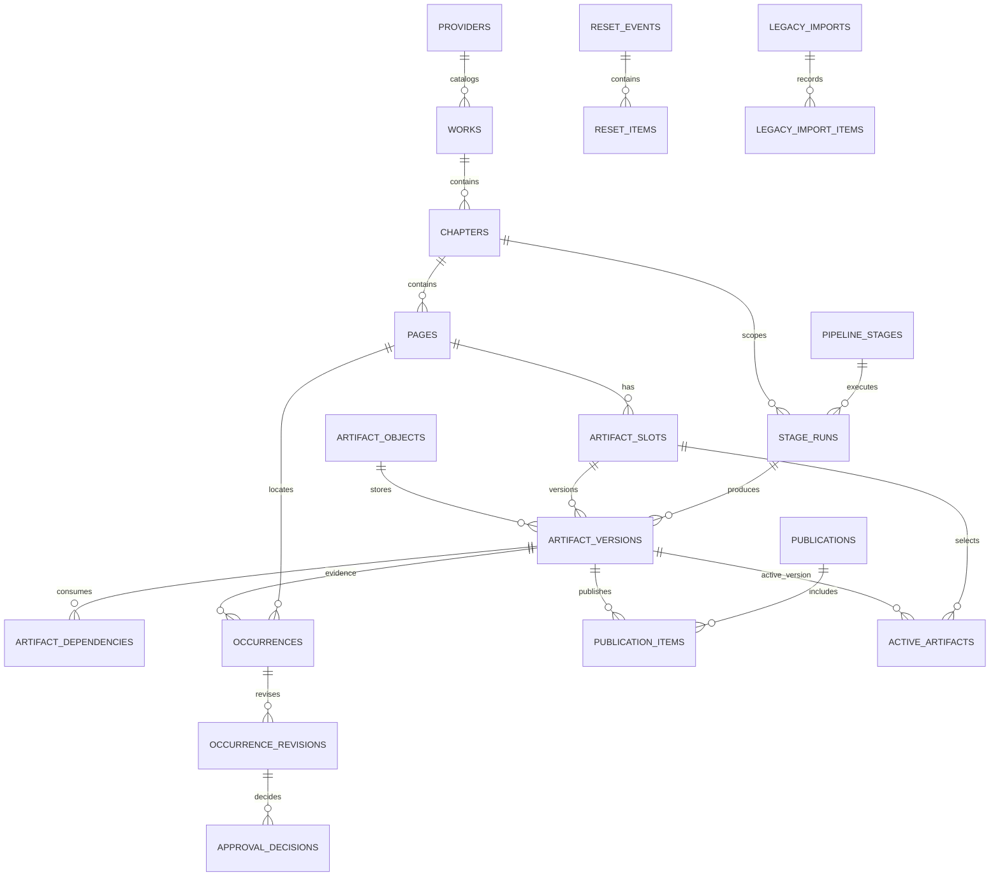

# M2 — Modelo relacional PostgreSQL proposto

**Status:** proposta conceitual para aprovação; não criar tabelas a partir deste documento sem revisão e migrations autorizadas.
**Convenções de desenho:** timestamps UTC; PKs UUIDv4 gerados na camada de persistência e mantidos em reimport; JSONB apenas para parâmetros/evidência que não substitui relações centrais; SHA-256 em representação binary/hex validada. O formato físico de encoding do SHA pode ser escolhido na migration sem alterar a semântica.

## Diagrama lógico

`source_pages` identifica somente páginas de entrada de uma obra/capítulo. `derived_segments` identifica páginas/segmentos compostos produzidos pelo MERGE ou por outro contrato; nunca reutiliza `source_page_id`. Cada revisão de segmento guarda os trechos ordenados de uma ou mais versões de source page que compõem aquele resultado. A decisão de não colapsar origem e derivado está fechada neste desenho.

## Tabelas propostas

### Catálogo e etapas

| Tabela | Campos essenciais | Chaves e restrições propostas |
|---|---|---|
| `providers` | `provider_id`, `code`, `display_name`, `created_at` | PK `provider_id`; `code` único, estável e não dependente de diretório |
| `works` | `work_id`, `provider_id`, `external_key`, `display_name`, `catalog_status`, `created_at` | FK provider; único `(provider_id, external_key)`; names podem mudar sem alterar ID |
| `work_path_aliases` | `alias_id`, `work_id`, `path`, `valid_from`, `valid_to`, `source` | caminho único enquanto vigente; histórico de renomeações/aliases |
| `chapters` | `chapter_id`, `work_id`, `chapter_key`, `display_order`, `legacy_path`, `created_at` | FK work; único `(work_id, chapter_key)`; ordem pode ser null e não é identidade |
| `source_pages` | `source_page_id`, `chapter_id`, `source_key`, `original_filename`, `display_order`, `created_at` | único `(chapter_id, source_key)`; `source_key` preserva a identidade do arquivo catalogado; filename não muda PK |
| `source_page_aliases` | `alias_id`, `source_page_id`, `filename/path`, `valid_from`, `valid_to`, `source` | aliases temporais; não sobrepor intervalos ativos para a mesma obra/capítulo/key; mudança de nome adiciona alias |
| `derived_segments` | `segment_id`, `chapter_id`, `segment_key`, `created_at`, `retired_at` | único `(chapter_id, segment_key)`; identidade estável da saída lógica no catálogo, sem afirmar equivalência semântica após recomposição |
| `derived_segment_versions` | `segment_version_id`, `segment_id`, `stage_run_id`, `version_no`, `created_at` | único `(segment_id, version_no)`; cada execução que altera composição cria nova versão; fatos da composição são imutáveis; validade é registrada por evento, não coluna mutável |
| `segment_source_ranges` | `segment_version_id`, `ordinal`, `source_page_id`, `source_artifact_version_id`, `start_offset`, `end_offset`, `coordinate_space`, `details_json` | PK `(segment_version_id, ordinal)`; FKs compostas garantem source artifact da mesma source page/capítulo; ranges válidos e ordenados; segmentos sem origem ficam explicitamente não verificados |
| `pipeline_stages` | `stage_id`, `stage_code`, `display_name`, `contract_version`, `stage_class`, `active` | PK; `stage_code` único; versões de contrato mantidas, não atualizadas in-place |

### Execuções e artefatos

| Tabela | Campos essenciais | Chaves e restrições propostas |
|---|---|---|
| `stage_runs` | `stage_run_id`, `stage_id`, `run_key`, `scope_type`, `status`, `started_at`, `finished_at`, `actor_id`, `algorithm`, `algorithm_version`, `manifest_schema`, `parameters_json`, `request_fingerprint`, `error_code` | FK stage; scope `CHAPTER`, `PAGE`, `SEGMENT` ou `BATCH`; `run_key` único por `(stage_id, run_key)`; concluído requer `finished_at`; DB controla transições permitidas |
| `stage_run_scopes` | `stage_run_id`, `chapter_id`, nullable `source_page_id`, nullable `segment_id`, `ordinal` | PK `(stage_run_id, ordinal)`; scope `CHAPTER` tem só chapter, `PAGE` só page, `SEGMENT` só segment, `BATCH` múltiplos; CHECK de exatamente um nível por row e FKs compostas garantem pertencimento ao chapter; Combo pode conter várias chapters |
| `stage_run_events` | `event_id`, `stage_run_id`, `event_type`, `occurred_at`, `actor_id`, `details_json` | append-only; índice `(stage_run_id, occurred_at)` |
| `artifact_objects` | `object_id`, `sha256`, `byte_size`, `media_type`, `storage_key`, `created_at`, `verified_at` | PK object; `sha256` único para deduplicação física; size >= 0; SHA format check; storage key único. Mesmo conteúdo pode ser usado por várias versões |
| `artifact_slots` | `artifact_slot_id`, `chapter_id`, `subject_type`, nullable `source_page_id`, nullable `segment_id`, `stage_id`, `role`, non-null `context_key`, `created_at` | CHECK: subject é `CHAPTER` com ambos IDs nulos, `SOURCE_PAGE` com só `source_page_id`, ou `DERIVED_SEGMENT` com só `segment_id`; composite FK `(chapter_id, source_page_id)`/`(chapter_id, segment_id)`; unique parcial por chapter+stage+role+context, source page+stage+role+context, segment+stage+role+context; `context_key` vazio canônico quando ausente |
| `artifact_versions` | `artifact_version_id`, `artifact_slot_id`, `stage_run_id`, `object_id`, `version_no`, `created_at`, `source_legacy_path`, `manifest_fields_json` | UNIQUE `(artifact_slot_id, version_no)`, `(artifact_slot_id, artifact_version_id)`, `(stage_run_id, artifact_version_id)`; composite FKs de slot/run; dados factuais imutáveis após commit; validade/stale vai a eventos, não `lifecycle_status` mutável |
| `stage_run_artifacts` | `stage_run_id`, `scope_ordinal`, `artifact_version_id`, `direction`, `artifact_role`, `ordinal` | PK `(stage_run_id, artifact_version_id, direction)`; FK composta `(stage_run_id, artifact_version_id)` para `artifact_versions`; FK `(stage_run_id, scope_ordinal)` para `stage_run_scopes`; CHECK separa `INPUT`/`OUTPUT`/`EVIDENCE`; CHECK/FK condicionais fazem subject/slot coincidir com o scope; `OUTPUT` exige `artifact_versions.stage_run_id = stage_run_id`; inputs/evidence podem vir de runs anteriores, mas devem pertencer ao scope declarado ou ser evidência explicitamente global do batch |
| `artifact_dependencies` | `consumer_version_id`, `input_version_id`, `dependency_role`, `required`, `observed_sha256`, `created_at` | PK `(consumer_version_id, input_version_id, dependency_role)`; FKs; CHECK sem auto-ciclo; inserção validada em SERIALIZABLE com detecção de caminho reverso para prevenir ciclos concorrentes; aresta fixa após versão selada |
| `approval_dependencies` | `consumer_version_id`, `approval_subject_id`, `required_decision_id`, `created_at` | PK `(consumer_version_id, approval_subject_id)`; composite FK garante decisão pertencente ao subject; registra a decisão exata que autorizou o consumo; imutável após selagem da versão |
| `artifact_validations` | `validation_id`, `artifact_version_id`, `validation_type`, `status`, `validator_version`, `expected_sha256`, `observed_sha256`, `details_json`, `checked_at` | evidência append-only; status `PASS`/`FAIL`/`NOT_APPLICABLE`/`UNVERIFIED`; index por artefato/status |
| `artifact_state_events` | `state_event_id`, `artifact_version_id`, `state`, `cause_event_id`, `created_at`, `details_json` | append-only; states `STAGED`, `VALID`, `STALE`, `INVALID`, `QUARANTINED`; validade corrente é maior sequência/evento vigente. Não altera fatos da versão |
| `invalidation_outbox` | `event_id`, `cause_type`, nullable `source_slot_id`, nullable `source_version_id`, nullable `approval_subject_id`, nullable `approval_decision_id`, nullable `previous_version_id`, `new_revision`, `status`, `attempt_count`, `created_at`, `processed_at` | CHECK exige exatamente uma causa (`ARTIFACT_POINTER` ou `APPROVAL_DECISION`); FKs compostas validam causa; escrita na mesma transação que altera ponteiro ou decisão corrente; UNIQUE chave idempotente da causa/revisão; retry auditável |

`manifest_fields_json` é cópia controlada de campos relevantes para auditoria, não a fonte relacional duplicada para dependências/approval. Manifest original completo pode ficar como `EVIDENCE` em `artifact_versions` e bytes no object store.

### Ocorrências e aprovações

| Tabela | Campos essenciais | Chaves e restrições propostas |
|---|---|---|
| `occurrences` | `occurrence_id`, `source_page_id`, `first_seen_run_id`, `created_at` | identidade persistente da ocorrência vinculada à página fonte; ID antigo pode ser guardado como external alias |
| `occurrence_revisions` | `occurrence_revision_id`, `occurrence_id`, `revision_no`, `evidence_artifact_version_id`, `reviewed_image_version_id`, `source_occurrence_key`, `type_code`, `origin`, `candidate`, normalized ROI, pixel ROI, `policy_version`, `classification_json`, `created_at` | UNIQUE `(occurrence_id, revision_no)`; composite FK para reviewed image/source page; ROI normalizada em [0,1], width/height > 0 e dentro de bounds validados contra dimensões da reviewed image |
| `approval_batches` | `approval_batch_id`, `chapter_id`, `check_run_id`, `source_snapshot_version_id`, `status`, `created_at`, `closed_at` | composite FK check_run scoped to chapter/stage Check; source snapshot fechado e imutável |
| `approval_subjects` | `approval_subject_id`, `approval_batch_id`, `occurrence_revision_id`, `created_at` | UNIQUE `(approval_batch_id, occurrence_revision_id)`; composite FKs garantem mesma chapter/batch |
| `approval_decisions` | `approval_decision_id`, `approval_subject_id`, `decision_seq`, `supersedes_decision_id`, `decision`, `actor_id`, `decided_at`, `reason` | UNIQUE `(approval_subject_id, decision_seq)` e `(approval_subject_id, approval_decision_id)`; supersedes FK composta para mesma subject e sequência anterior; append-only |
| `current_approval_decisions` | `approval_subject_id` PK, `approval_decision_id`, `revision`, `updated_at` | composite FK garante decisão da mesma subject; somente row apontada é vigente; transação lock subject, append decision, compare-and-swap `revision` e grava evento de invalidação na mesma transação; `REVOKE` deixa sujeito sem aprovação válida |

Se uma página não tiver ocorrência, a aprovação vazia não deve ser inferida como “aprovada”; registrar fechamento/decisão de lote separado se fluxo exigir isso. A taxonomia atual de `occurrence_policy.py` deve ser carregada como versão de política identificada, não embutida como regra imutável no banco.

### Publicação, reset e auditoria

| Tabela | Campos essenciais | Chaves e restrições propostas |
|---|---|---|
| `publications` | `publication_id`, `chapter_id`, `stage_run_id`, `status`, `expected_active_revision`, `idempotency_key`, `created_at`, `committed_at`, `actor_id`, `reason`, `manifest_version_id` | UNIQUE `(chapter_id, idempotency_key)`; `UNIQUE (publication_id, chapter_id)`; status controlado; stage run/manifest pertencem ao chapter; compare-and-swap em revisão do active pointer |
| `publication_items` | `publication_id`, `chapter_id`, `artifact_slot_id`, `artifact_version_id`, `previous_version_id`, `published_at` | UNIQUE `(publication_id, artifact_slot_id)` e tripla; FKs compostas ao capítulo do publication, slot, versão daquele slot; objeto validado e approvals/dependencies rechecados no commit |
| `active_artifacts` | `artifact_slot_id` PK, `artifact_version_id`, `publication_id`, `revision`, `updated_at` | composite FK `(artifact_slot_id, artifact_version_id)` para version; triple FK `(publication_id, artifact_slot_id, artifact_version_id)` para publication item; revisão incrementa exatamente 1 sob row lock/CAS |
| `reset_events` | `reset_event_id`, `chapter_id`, nullable `source_page_id`, nullable `segment_id`, `reset_type`, `actor_id`, `reason`, `created_at`, `source_version_id`, `target_version_id`, `approval_batch_id`, `idempotency_key` | append-only; mesma regra de owner subject (chapter/page/segment); origem/destino/approval references pertencem à mesma entidade/chap; idempotency unique |
| `reset_items` | `reset_event_id`, `artifact_slot_id`, `from_version_id`, `to_version_id`, `backup_version_id`, `invalidated_run_id` | FKs compostas impedem cruzar slot/versão; vários items por evento; cada invalidated run é row própria; preserva versão revertida |
| `audit_events` | `audit_event_id`, `aggregate_type`, `aggregate_id`, `event_type`, `actor_id`, `occurred_at`, `correlation_id`, `payload_json` | append-only; payload sem segredos; index por aggregate e tempo |

### Importação e compatibilidade

| Tabela | Campos essenciais | Restrições propostas |
|---|---|---|
| `legacy_import_batches` | `import_batch_id`, `source_root_id`, `started_at`, `finished_at`, `importer_version`, `status`, `report_object_id` | import repetível/idempotente por lote e fingerprint |
| `legacy_import_items` | `import_item_id`, `import_batch_id`, `legacy_path`, `legacy_sha256`, `contract_code`, `classification`, `artifact_version_id`, `issue_code`, `details_json` | UNIQUE `(import_batch_id, legacy_path, legacy_sha256)`; FK artifact; classification inclui `VERIFIED`, `LEGACY_UNVERIFIED`, `IGNORED_BY_SCOPE`, `CONFLICT` |
| `legacy_path_aliases` | `alias_id`, `artifact_version_id`, `path`, `valid_from`, `valid_to`, `consumer_owner`, `status` | aliases temporais; vários paths podem apontar para uma versão, sem virarem authority concorrente |

## Cardinalidades e regras globais

- Provider 1:N works; work 1:N chapters; chapter 1:N source pages e derived segments. Cada segment version tem N source ranges vinculadas a versões exatas de source page.
- Stage 1:N runs; run N:M chapters/pages/segments via scopes; run 1:N artifact versions; cada versão liga exatamente um slot e um object. JSON manifest/report é também object `EVIDENCE`, não exceção sem identidade física.
- Versão pode depender de N versões de input e ser dependência de N saídas. Grafo precisa ser acíclico para relações `INPUT` da pipeline; validar no service transaction, pois FK simples não garante DAG.
- Blob 1:N versões lógicas. `sha256` único não limita quantas páginas/roles/execuções referenciam os mesmos bytes.
- Slot tem no máximo uma versão ativa por vez; partial unique indexes separam subject type e chapter-level slot. Active pointer só referencia versão daquele slot e publication item correspondente.
- Publication 1:N itens; item referencia versão imutável do slot/chapter corretos. Version, run, slot, subject e publication são coerentes via FKs compostas, não só validação do serviço.
- Approval subject tem no máximo uma decisão vigente apontada; nova decisão seq+1 faz compare-and-swap sob lock, retendo a anterior.
- Artefato que exige Check/approval registra sua dependência em `approval_dependencies`; nova decisão, revogação ou mudança de pointer de aprovação invalida transitivamente esses consumers, mesmo sem alteração de blob/active artifact.
- Para qualquer gravação sujeita a concorrência, a unicidade é imposta no banco. Inserção de dependência usa transação SERIALIZABLE com busca de caminho reverso; alteração de ponteiro e publicação usa row lock + revision compare-and-swap; colisão de idempotency key com fingerprint diferente é conflito, nunca update.
- Chaves compostas devem carregar o owner (`chapter_id`, `artifact_slot_id`, `stage_run_id` ou `approval_subject_id`) em todas as relações dependentes. Onde um CHECK não puder garantir coerência cross-table, a constraint é implementada por FK composta para uma chave candidata redundante ou trigger restritiva no banco; validação apenas na aplicação não satisfaz a invariante.
- Para as coerências cross-table que não podem ser expressas como FK — `stage_run_artifacts` scope ↔ subject do slot, versão ↔ mesmo slot/run, e item ↔ chapter/version do publication — usar constraint trigger transacional que verifica todas as relações antes do commit e bloqueia os rows envolvidos. Não confiar em trigger de aplicação; escritas concorrentes ainda ficam protegidas por candidate keys/FKs e CAS/isolamento especificados.
- Aliases com período de vigência usam intervalo half-open `[valid_from, valid_to)` e exclusion constraint por chave/owner para rejeitar intervalos sobrepostos. `context_key` ausente é armazenado como valor canônico vazio, para unicidade não depender da semântica de `NULL`.
- Transições concorrentes permitidas: `stage_run` segue estados enumerados com evento append-only; `artifact_version` registra fatos uma vez e acumula eventos de validade; publication passa por `STAGED → COMMITTED` ou `CONFLICT/ABORTED`; approval decision é append e o current pointer avança uma revisão por CAS; reset é novo evento/item e nunca update destrutivo.

## Restrições de integridade e segurança

- FKs `ON DELETE RESTRICT` para catálogo, runs, objetos, versões, aprovações, publicações e resets. Não fazer cascade destrutivo de histórico.
- Deletar catálogo/objeto só por processo de retenção aprovado, depois de comprovar que nenhuma versão ativa/histórica retida o referencia.
- `NOT NULL` para identidade, papel, status, timestamps e dependências requeridas; enums/domains versionados para estados estáveis; CHECKs e composite FKs para subject/page/segment, stage-run/output, slot/version, approval decision e publication/pointer.
- Validar autorização e paths no serviço; nunca aceitar path absoluto livre de cliente. Armazenar storage key relativa e imutável, não caminho local como identidade.
- Não guardar imagem/máscara como bytea no PostgreSQL; `artifact_objects` registra metadados e localização.
- Escrita append-only em tabelas de versão/approval/publication/reset/evento é imposta por roles DB sem UPDATE/DELETE e triggers de rejeição; correções criam novos rows. Eventual retenção/GC fica em role privilegiada separada, com event/audit log e aprovação operacional.

## Consultas críticas a suportar

1. Resolver versão ativa por provider/obra/capítulo/página/role/contexto e validar que não está stale/invalid.
2. Ver todas as dependências diretas e transitivas de uma versão e calcular downstream afetado por nova revisão.
3. Obter decisões vigentes para Check, ligadas à imagem exata que o usuário revisou.
4. Listar publicações/histórico por página e recuperar objeto de uma versão superseded.
5. Reconciliar stage run/publicação interrompida com object keys existentes.
6. Localizar e tratar `LEGACY_UNVERIFIED`, conflitos e ausências por import batch.

## Parâmetros de implementação a detalhar sem alterar as invariantes

Definir schema names, estratégias de particionamento/índices, tenancy, mecanismo de actor/identity, enums e versão PostgreSQL suportada. O formato lógico de IDs, relações, FKs compostas, approval pointer, CAS e escopo multi-capítulo foram resolvidos neste desenho. Nenhuma migration ou tabela real foi criada.
